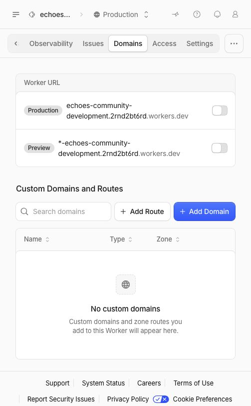

# R-04c.1b — wynik pierwszego rzeczywistego logowania

Próba została wykonana po konkretnej zgodzie właściciela na [ten zakres](ZAKRES_PIERWSZEJ_PROBY_LOGOWANIA.md). **Logowanie, odtworzenie, odnowienie sesji i logout-all zaliczone na fizycznym iPhonie 15 Pro; dokładne sprzątanie potwierdzone.** [Dowody](evidence/first-authentication-trial-device-acceptance.json).

## Wynik funkcjonalny

| Sprawdzenie | Rzeczywisty wynik |
| --- | --- |
| Jeden natywny arkusz Apple / FaceID | Właściciel potwierdził „zalogowano”; aplikacja otrzymała zwalidowany UUID konta z prawdziwej bramki. Bez żądania name/email i bez ponawiania interaktywnego logowania |
| Zimny restart przed wygaśnięciem | To samo konto odtworzone przez rzeczywisty Runtime/Keychain, bez kolejnego arkusza Apple |
| Zimny restart po rzeczywistym wygaśnięciu | Gotowość tego samego konta po 673 s od obserwacji pierwszego logowania. Sprawdzono zarówno czas ścienny, jak i monotoniczny; bez przestawiania zegara lub polityki |
| Dowód odnowienia po stronie serwera | W SQLite proof_sequence wzrosło z 0 do 1, expires_at z 1795720896330 do 1795721651636. Jedno konto i jedna bieżąca sesja |
| Wylogowanie wszystkich urządzeń | Właściciel potwierdził ekran wylogowany; generation wzrosło z 0 do 1 i zniknął renewal grant. Pozostający stary wiersz sesji nie został przedstawiony jako fizycznie usunięty przez logout; usunięto go następnie w kontrolowanym cleanup |
| Odwołanie zgody Apple | Właściciel sam wykonał tę czynność w ustawieniach i potwierdził „zgoda cofnięta”. To nie jest dowód serwerowego endpointu OAuth revoke |

Prywatny UUID z telefonu odpowiada UUID pierwszego logowania i obu restartów. Surowy identyfikator, subject hash, credential ID, code, tokeny i wartości Keychain pozostały poza Git; raport publiczny przechowuje wyłącznie skrót UUID i wyniki.

## Konfiguracja i sprzątanie

Wspólne okno backendu i podpisanego Debug: **2026-11-26 19:07:38–19:52:38 UTC**, bez przedłużenia. Włączono tylko auth w `echoes-community-development` na potwierdzonym Workers Free. Wszystkie funkcje community/deletion/avatar/retention pozostały wyłączone. Nie przekazano Cloudflare klucza CloudKit. Próba nie używała profilu, zdjęć, GPS ani Muzyki i nie zmieniała Production lub Firebase.

Użyto istniejącego ważnego certyfikatu Apple Development. Apple wygenerował profil `Echoes Auth Trial Development` dla właściwego App ID, jednego istniejącego certyfikatu i wyłącznie obecnego telefonu. Aplikację zbudowano bez podpisu, następnie podpisano dokładnymi uprawnieniami CloudKit Development i Sign in with Apple; podpis i profil zweryfikowano przed instalacją. Instalacja zastąpiła Debug bez odinstalowania lub kasowania danych.

Po logout zatrzymano klienta, wyłączono workers.dev i previews, przywrócono wszystkie flagi źródłowe do 0 oraz usunięto cztery aktywne secret bindings. API potwierdziło niezmieniony namespace i brak aktywnych sekretów/trasy. Tymczasowy token Individual Workers Editor ograniczony do tej jednej usługi usunięto; rzeczywista kontrola API zwróciła 401, a jego lokalną wartość usunięto. SIWA QPBMSAY553 pozostaje zarejestrowany zgodnie ze zgodą; historyczne wersje Cloudflare/PITR mogą nadal zawierać przekazane sekrety.

Po ręcznym cofnięciu zgody Apple wykonano dokładny inwentarz metadanych jedynego konta. Nie odczytywano sealed_credential. Przy `eligible=1` zastosowano siedem osobnych, ponownie kontrolowanych DELETE z istniejącego generatora: własny challenge, sessions, grants, apple state, credential, reset fence i konto na końcu. Kontrolę eligible powtórzono przed usunięciem konta. **Każdy z ośmiu końcowych count zwrócił 0.** Łącznie 23 zdalne instrukcje SQL, wliczając wcześniejsze odczyty diagnostyczne; limit 40 zachowany. Nie usunięto namespace, tabel, nieznanych wyzwań ani liczników. Czas zakończenia cleanup zapisano w dowodach; mieści się w 2 h od startu.

## Poprawka i walidacja kodu

Wykryto brak izolacji zwykłego startu: stary Root wybierał ekran logowania tylko przez zmienną uruchomienia. `Echo/EchoApp.swift` odczytuje teraz podpisaną flagę `EchoesGatewayAuthenticationTrial` także przed inicjalizacją AppServices. W Debug otwiera izolowany ekran również z ikony, bez bootstrapu Firebase/starszych funkcji. Rzeczywiste logowanie i oba restarty wykonano bez zmiennej wybierającej ekran. Release zachowuje zwykły start.

Końcowy Debug urządzenia, Debug build-for-testing symulatora, unsigned Release oraz strict swift-format poprawne. Istniejący test `GatewayDeletionUITests/testUnconfiguredNativeGatewayDoesNotOfferADeletionOrSignInFallback` zaliczył 1/1 na iPhone 17 Pro Simulator / iOS 26.1. W rzeczywistym Release brak flagi próby, konfiguracji GatewayDevelopment oraz markera logu. Nie ponawiano niezmienionych pełnych zestawów backendu/natywnego Core.

Problemy narzędzi rozwiązane przed próbą: uszkodzony globalny cache SwiftPM omijano przez `-disablePackageRepositoryCache` i świeży cache dokładnie przypiętych rewizji, bez zmiany lockfile. Globalny wymuszony certyfikat kolidował z podpisywaniem zasobów SPM; zastosowano unsigned build i lokalne podpisanie gotowego pakietu. Początkowy argument launchServicesIdentifier był dosłownym `unknown`, więc CLI odmówiło przed startem; właściwe uruchomienie użyło Bundle ID. Walidator profilu musiał uwzględnić wildcard/listę grantów Apple, zachowując w podpisie dokładne węższe Development. W helperze obserwacji SQL użyto pełnego drzewa zamiast diff, bez powtórzenia zakończonego DELETE. Zastany projekt użytkownika zachowany bajtowo.

## Pozostała praca

To zalicza pierwsze prawdziwe logowanie i krótką rotację sesji, **nie całą R-04 ani migrację**. Polityka sprawdzania Apple po 24 h nie została skrócona; rzeczywisty serwerowy refresh i revoke pozostają do odbioru. Nadal wymagane: query/indeksy R-02, pliki R-03, dwa zwykłe konta R-05, retencja/usuwanie i odtworzenie, pełny przepływ aplikacji oraz przełączenie Firebase. [Bieżąca mapa](ODBIOR_MIGRACJI_STAN_I_KOLEJNOSC.md). Konto właściciela z rolą administratora nie zastępuje A/B. Aplikacja nie jest jeszcze gotowa do TestFlight.
